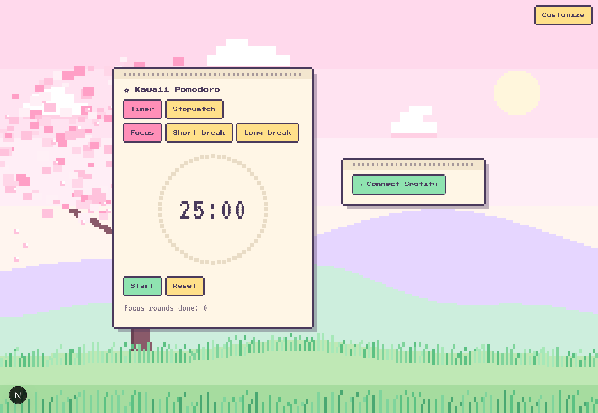
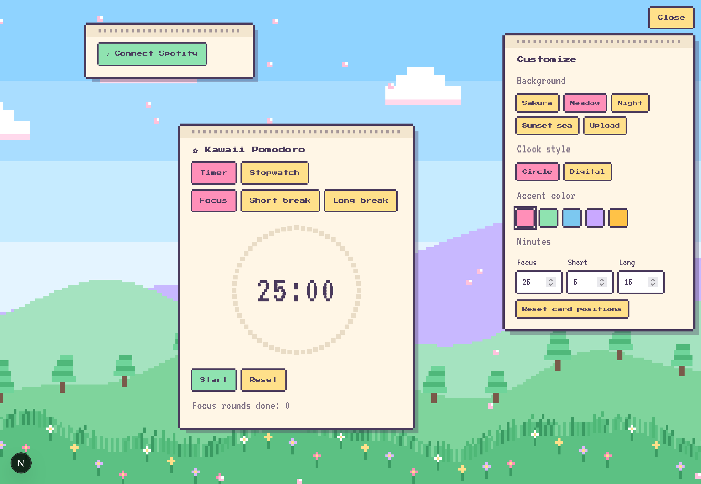

# Kawaii Pixel Pomodoro

A cozy, kawaii-styled Pomodoro timer with drag-and-move cards, customizable backgrounds, and optional Spotify playback.

## Features

- Focus, short-break, and long-break timers
- Ring and digital clock styles
- Sakura, meadow, night, and sunset-sea themes
- Scene-specific GPU-shader motion: meadow flowers and wind, falling sakura petals and wind, night fireflies and swaying grass, and moving sunset-sea water
- Custom uploaded image or video backgrounds
- Accent-color customization
- Spotify playlist, album, artist, and track playback
- Responsive kawaii pixel UI

## Screenshot

<!-- Save a project screenshot as screenshots/pomodoro.png -->

## Local setup

1. Run `npm install`.
2. Create an app at https://developer.spotify.com/dashboard.
3. Enable **Web Playback SDK**.
4. Add `http://127.0.0.1:3000/` as a redirect URI. The trailing slash is required.
5. Copy `.env.example` to `.env.local`.
6. Set `NEXT_PUBLIC_SPOTIFY_CLIENT_ID` and `NEXT_PUBLIC_SPOTIFY_REDIRECT_URI`.
7. Run `npm run dev`, then open `http://127.0.0.1:3000/`.

Spotify browser playback requires a Spotify Premium account.
